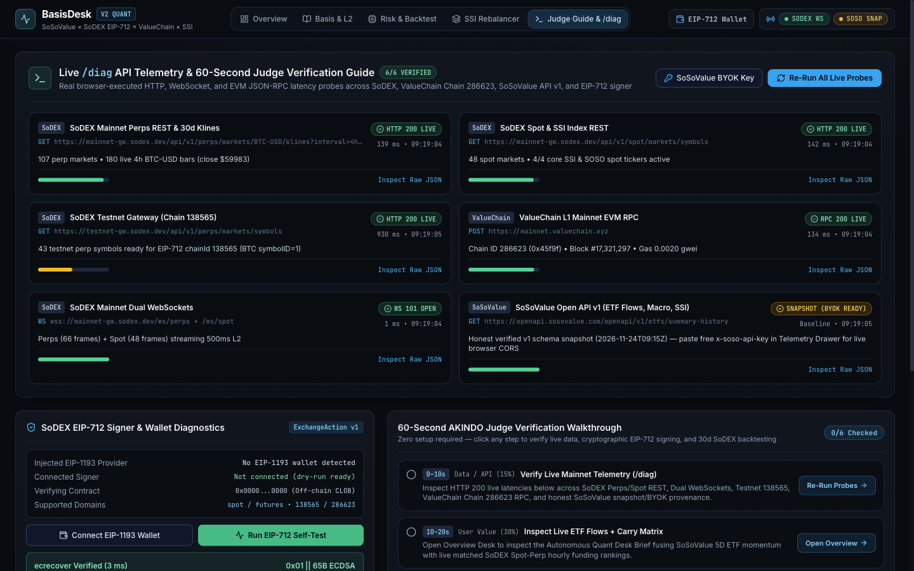
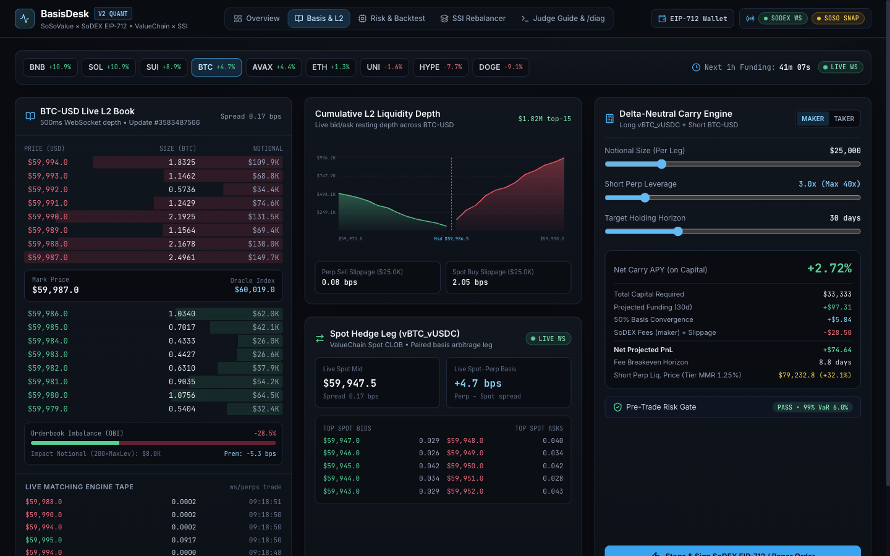
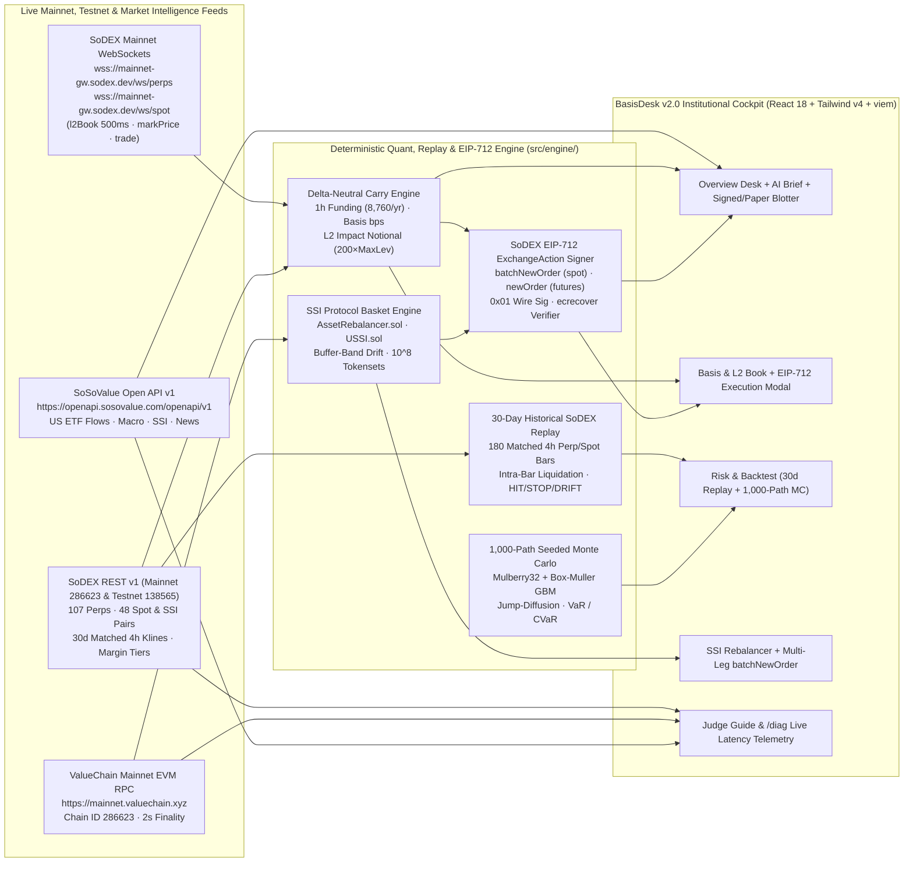

# BasisDesk v2.0 — Autonomous One-Person On-Chain Quant & Risk Terminal

> **Built for AKINDO WaveHack (Wave 3 — Build Phase II):** *Build Your One-Person On-Chain Finance Business with SoSoValue × ValueChain × SoDEX*
> **Live App (GitHub Pages):** [https://alphonshhhomenicmtu.github.io/basisdesk-soso/](https://alphonshhhomenicmtu.github.io/basisdesk-soso/) • **Demo Video:** [Watch 1080p Walkthrough on YouTube](https://www.youtube.com/watch?v=a936c4mz-gk) • **Custody:** Non-custodial EIP-712 dry-run & paper blotter (zero silent mainnet broadcast) • **Disclaimer:** Analytical tooling — not financial advice.

BasisDesk v2.0 turns a solo trader or independent researcher into a disciplined on-chain quant desk. It unifies **real browser EIP-712 SoDEX `ExchangeAction` / `batchNewOrder` order signing**, a **real 30-day historical SoDEX klines & funding carry replay engine**, a **live `/diag` API telemetry & 60-second judge verification guide**, **streaming 500ms SoDEX Mainnet orderbooks**, **SoSoValue ETF flow & macro intelligence**, **ValueChain Chain 286623 RPC finality**, and **SSI Protocol smart contract basket rebalancing** into one institutional cockpit.

---

## Visual Walkthrough (v2.0 Retina Verified)

| Overview Desk (Live Carry Matrix + ETF Flows + Blotter) | Real Browser EIP-712 SoDEX Order Signer (`ExchangeAction`) |
| :---: | :---: |
|  |  |

| 30-Day Historical SoDEX Klines & Funding Replay | Live `/diag` Telemetry & 60-Second Judge Guide |
| :---: | :---: |
|  |  |

| Live SoDEX Basis & 500ms L2 Orderbook Desk | SSI Protocol Index Rebalancer & Multi-Leg `batchNewOrder` |
| :---: | :---: |
|  |  |

---

## What's New in V2.0 (Wave 3 Upgrade)

1. **Real Browser EIP-712 SoDEX Order Signing (`src/engine/sodexEip712.ts`):**
   - Implements SoDEX's official `ExchangeAction(bytes32 payloadHash, uint64 nonce)` EIP-712 specification (`docs.sodex.com`) for both Spot **`batchNewOrder`** (`domain.name = "spot"`, `/api/v1/spot/trade/orders/batch`) and Perps **`newOrder`** (`domain.name = "futures"`, `/api/v1/perps/trade/orders`).
   - Preserves exact Go struct field ordering for canonical `keccak256` `payloadHash`, `verifyingContract = 0x0000...0000`, millisecond `uint64` nonce, and SoDEX's required 66-byte `0x01 || r || s || v` wire signature prefix (`X-API-Sign`).
   - Supports **MetaMask / Rabby / EIP-1193 (`window.ethereum`)** `eth_signTypedData_v4` signing (with live public `accountID` lookup via `/perps/accounts/{address}/state`) PLUS a **Zero-Wallet Cryptographic Dry-Run verifier** using `viem` secp256k1 `recoverTypedDataAddress` so judges without a browser wallet can inspect and verify real EIP-712 signatures live.
   - Enforces an explicit **Mainnet Safety Confirmation Gate** when switching from **SoDEX Testnet (`138565`)** to **ValueChain Mainnet (`286623`)** and never auto-broadcasts orders.
2. **Real 30-Day Historical SoDEX Klines & Funding Backtest (`src/engine/backtest.ts`):**
   - Fetches 180 matched 4-hour candles (`30.0` days = `720` hours) directly from live SoDEX Mainnet REST (`/perps/markets/{sym}/klines?interval=4h&limit=180` and `/spot/markets/{spot}/klines?interval=4h&limit=180`), with pre-captured `SNAPSHOT` fallback in `market-snapshot.json` and honest `LIVE KLINES` / `SNAPSHOT KLINES` badges.
   - Replays delta-neutral basis carry using SoDEX's official hourly funding formula `(P + clamp(0.0001 - P, -0.0005, +0.0005)) / 8`, checks intra-bar `perpHigh` wicks against SoDEX tiered maintenance margins for historical liquidation detection, benchmarks against unhedged Spot Buy-and-Hold, and audits 6 rolling 5-day signal cohorts (`HIT / STOP / DRIFT / OPEN`).
3. **Live `/diag` API Telemetry & 60-Second Judge Verification Guide (`src/components/JudgeDiagDesk.tsx`):**
   - Dedicated **`Judge Guide & /diag`** tab running live browser HTTP/RPC/WS latency probes across SoDEX Mainnet Perps & Spot REST, Dual WebSockets, SoDEX Testnet `138565`, ValueChain Mainnet RPC `286623`, and honest SoSoValue API v1 provenance — complete with raw JSON payload inspection, 1-click EIP-712 `ecrecover` self-test, and clickable 60-second AKINDO rubric steps.

---

## System Architecture



---

## Live Integrations & Honest Telemetry

Every module explicitly labels its real data state (`LIVE WS`, `LIVE REST`, `LIVE RPC`, `LIVE API`, `SNAPSHOT`, or `FALLBACK`):

| Ecosystem Pillar | Verified Endpoint / Specification | Live Mode | Fallback / Safety |
| :--- | :--- | :--- | :--- |
| **SoDEX Perps & Klines** | `wss://mainnet-gw.sodex.dev/ws/perps` & `/api/v1/perps/markets/*` | **LIVE WS + REST** (`107` contracts, 500ms `l2Book`, `180×4h` live klines, `marginTiers`) | Pre-captured 30d klines in `market-snapshot.json` |
| **SoDEX Spot & SSI** | `wss://mainnet-gw.sodex.dev/ws/spot` & `/api/v1/spot/markets/*` | **LIVE WS + REST** (`48` pairs incl. `vMAG7ssi_vUSDC`, `vDEFIssi_vUSDC`, `vUSSI_vUSDC`, `WSOSO_vUSDC`) | Pre-captured 30d spot klines in `market-snapshot.json` |
| **SoDEX EIP-712 Signing** | `ExchangeAction(bytes32 payloadHash, uint64 nonce)` (`spot`/`futures`, `138565`/`286623`) | **EIP-1193 Wallet (`window.ethereum`) + Local `ecrecover` Dry-Run** | Mainnet safety confirmation gate; zero silent broadcast |
| **ValueChain L1 EVM** | `https://mainnet.valuechain.xyz` (Chain ID `286623`, 2s finality) | **LIVE RPC** (polled every 6s for `eth_blockNumber` & `eth_gasPrice`) | Latest captured block height in snapshot |
| **SoSoValue Open API v1** | `https://openapi.sosovalue.com/openapi/v1/{etfs/summary-history,market/overview,indices/ssimag7/constituents,news}` | **LIVE API (BYOK)** — paste free `x-soso-api-key` in Telemetry Drawer (memory-only, CORS-enabled) | Verified v1 schema snapshot honestly labeled `SNAPSHOT` |
| **SSI Protocol Contracts** | `SoSoValueLabs/ssi-protocol` (`AssetRebalancer.sol`, `AssetToken.sol`, `USSI.sol`) | Live ValueChain `SOSO` gas + live SoDEX spot pricing + multi-leg `batchNewOrder` signing | Deterministic `10^8` tokenset preview |

---

## Quick Start & Verification

```bash
npm install
npm run snapshot   # Refresh live SoDEX 30d klines + ValueChain RPC baseline
npm test           # Run full Vitest suite (quant + EIP-712 + 30d backtest + SSI)
npm run lint       # Strict TypeScript check (tsc --noEmit)
npm run build      # Build relative-path static bundle into ./dist
npm run preview    # Preview production dist/ locally at http://127.0.0.1:4173
```

---

## Wave 3 Progress Changelog

- **v2.0 (Wave 3 Champion Upgrade):**
  - Added full browser **SoDEX EIP-712 `ExchangeAction` signer** (`batchNewOrder` Spot + `newOrder` Perps) with exact Go struct field ordering, `0x01` 66-byte wire signature prefix, MetaMask/EIP-1193 wallet support, zero-wallet `viem` secp256k1 `ecrecover` dry-run verification, and explicit Mainnet Chain `286623` safety confirmation modal.
  - Built **30-Day Historical SoDEX Klines & Funding Carry Replay Engine** pulling 180 live matched 4-hour Perp & Spot candles from `mainnet-gw.sodex.dev`, evaluating SoDEX's official hourly funding formula, intra-bar high-wick liquidation breaches, Spot Buy-and-Hold alpha, Sharpe/Sortino, and `HIT/STOP/DRIFT/OPEN` signal track records.
  - Shipped dedicated **`Judge Guide & /diag`** workspace tab executing live browser HTTP/RPC/WS latency probes across all ecosystem endpoints with expandable raw JSON previews, 1-click EIP-712 self-test, and clickable 60-second AKINDO verification steps.
  - Expanded Vitest coverage with dedicated unit suites for EIP-712 typed-data/ecrecover verification and 30-day historical klines/liquidation backtesting.
- **v1.0 (Wave 3 — Build Phase II Foundation):**
  - Dual live SoDEX WebSockets, ValueChain Chain `286623` live RPC heartbeat, SoSoValue Open API v1 BYOK + snapshot pipeline, 1,000-path seeded Monte Carlo VaR/CVaR stress lab, SSI Protocol basket rebalancer, and 5-rule guarded Paper Execution Blotter.
