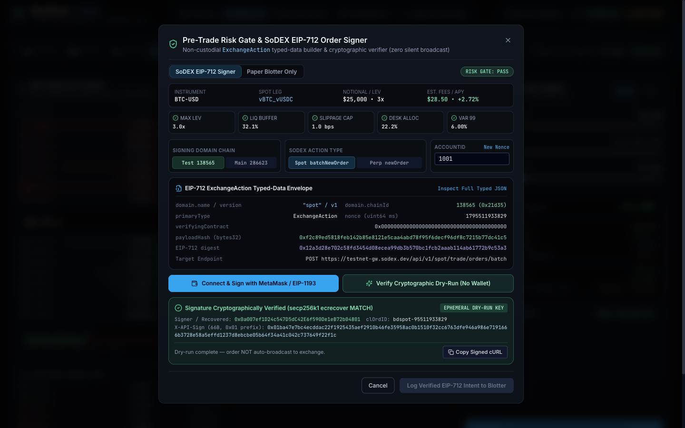
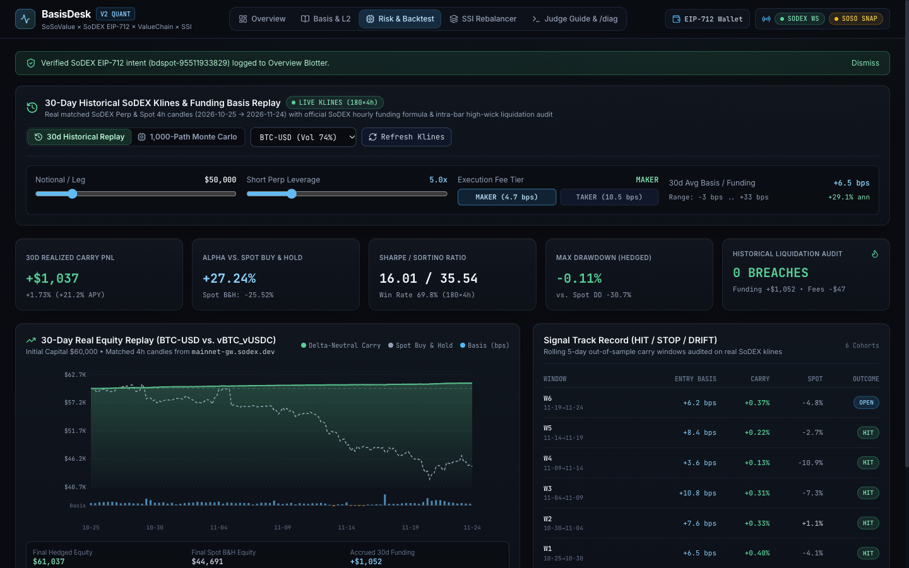
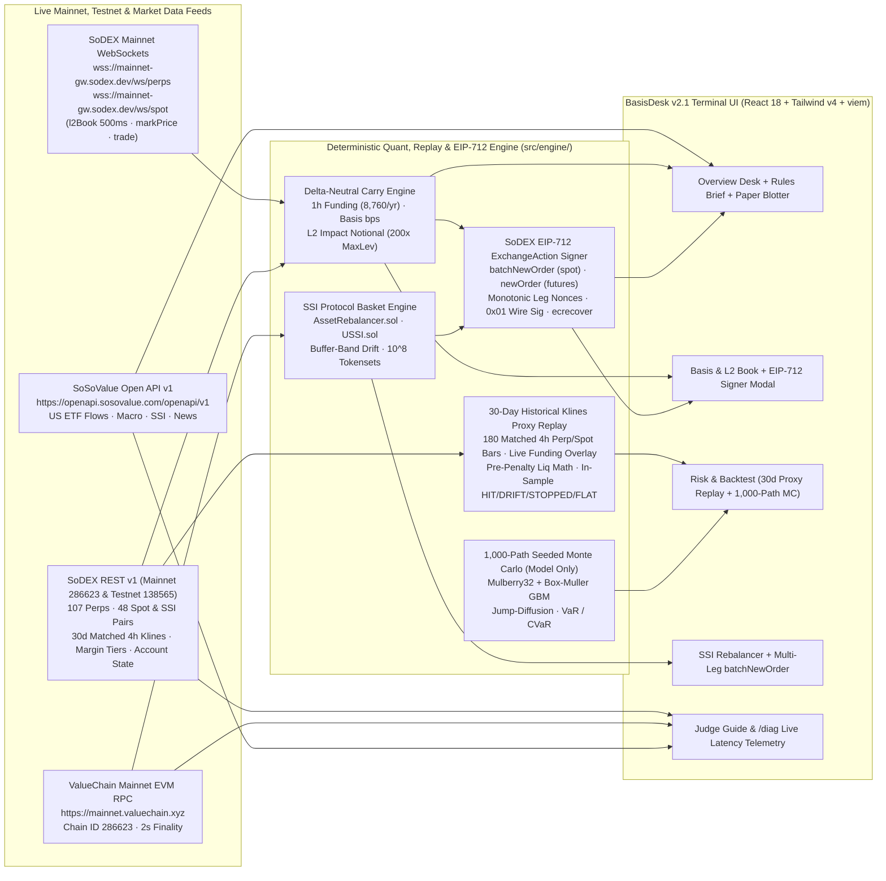

# BasisDesk v2.1 — One-Person On-Chain Quant & Risk Terminal

> **Built for AKINDO WaveHack (Wave 3 — Build Phase II):** *Build Your One-Person On-Chain Finance Business with SoSoValue × ValueChain × SoDEX*
> **Live App (GitHub Pages):** [https://alphonshhhomenicmtu.github.io/basisdesk-soso/](https://alphonshhhomenicmtu.github.io/basisdesk-soso/) • **Demo Video:** [Watch 1080p Walkthrough on YouTube](https://www.youtube.com/watch?v=a936c4mz-gk) • **Custody:** Non-custodial EIP-712 order builder & local paper blotter (zero silent broadcast) • **Disclaimer:** Analytical tooling, not financial advice.

BasisDesk v2.1 gives a solo trader or independent researcher a direct terminal for delta-neutral basis carry, risk auditing, and SSI basket rebalancing on SoDEX and ValueChain. It combines **browser EIP-712 SoDEX `ExchangeAction` order signing** (Spot `batchNewOrder` and Perps `newOrder`), a **30-day historical SoDEX 4h klines basis-proxy replay engine**, a **live `/diag` telemetry & 60-second verification screen**, **streaming 500ms SoDEX Mainnet orderbooks**, **SoSoValue ETF flow & macro feeds**, **ValueChain Chain 286623 RPC finality**, and **SSI Protocol drift rebalancing**.

---

## Visual Walkthrough

| Overview Desk (Live Carry Matrix + ETF Flows + Blotter) | Browser EIP-712 SoDEX Order Signer (`ExchangeAction`) |
| :---: | :---: |
|  |  |

| 30-Day Historical SoDEX Klines Proxy Replay | Live `/diag` Telemetry & 60-Second Verification Guide |
| :---: | :---: |
|  |  |

| Live SoDEX Basis & 500ms L2 Orderbook Desk | SSI Protocol Index Rebalancer & Multi-Leg `batchNewOrder` |
| :---: | :---: |
|  |  |

---

## What's in v2.1 (Wave 3 Surgical Audit & Quant Hardening)

1. **Spec-Verified Browser EIP-712 SoDEX Order Signer (`src/engine/sodexEip712.ts`, `src/components/Modals.tsx`):**
   - Implements SoDEX's `ExchangeAction(bytes32 payloadHash, uint64 nonce)` EIP-712 layout (`docs.sodex.com`) for both Spot **`batchNewOrder`** (`domain.name = "spot"`, `/api/v1/spot/trade/orders/batch`) and Perps **`newOrder`** (`domain.name = "futures"`, `/api/v1/perps/trade/orders`).
   - Preserves exact Go struct field ordering for `payloadHash = keccak256(utf8(JSON.stringify({ type, params })))`, `verifyingContract = 0x0000...0000`, `positionSide = 1` (one-way `BOTH`), and SoDEX's 66-byte `0x01 || r || s || v` wire signature prefix (`X-API-Sign`).
   - **Distinct monotonic nonces per hedge leg:** Switching between Spot `batchNewOrder` and Perp `newOrder` (or changing network) allocates a strictly greater `uint64` millisecond nonce so two legs signed in one session never collide inside SoDEX's `(T-2d, T+1d)` nonce window.
   - **Optional SoDEX Builder-Fee Attribution & Cost Breakdown:** Supports SoDEX's exact Go-ordered `builder: { id, fee }` (`omitempty`) field on both Spot `batchNewOrder` and Perp `newOrder` envelopes alongside `/api/v1/user/{address}/builder/summary` telemetry and an inline per-order receipt breaking out margin, SoDEX exchange fee, builder fee, and projected 24h funding.
   - **Live Spot + Perps `accountID` resolution with no fixture default:** Queries both `/spot/accounts/{address}/state` and `/perps/accounts/{address}/state` on Testnet (`138565`) and Mainnet (`286623`). Wallet signing and submittable cURL copy stay disabled until an activated `accountID` resolves from live account state. Master-wallet signatures omit `X-API-Key` (SoDEX recommends a registered API key for live trading); unregistered ephemeral keys are labeled strictly non-submittable.
   - Enforces an explicit **Mainnet Safety Confirmation Gate** when switching from **SoDEX Testnet (`138565`)** to **ValueChain Mainnet (`286623`)** and never auto-broadcasts orders.
2. **Auditable 30-Day Historical SoDEX Klines Replay (`src/engine/backtest.ts`, `src/components/RiskStressLab.tsx`):**
   - Pulls 180 matched 4-hour candles (`29.8d`, `716h` active gaps) from live SoDEX Mainnet REST (`/perps/markets/{sym}/klines?interval=4h&limit=180` and `/spot/markets/{spot}/klines?interval=4h&limit=180`) with timestamp-jitter tolerant alignment (`<= 60s`) and pre-captured `SNAPSHOT` fallback in `market-snapshot.json`.
   - **Honest funding proxy & live exchange overlay:** Clearly labels historical funding as a close-to-close basis proxy of SoDEX's 8h/8 clamp `(P + clamp(0.0001 - P, -0.0005, +0.0005)) / 8` (not settled 5-second impact-notional prints), and computes a live side-by-side overlay from current SoDEX ticker funding so differences between close-basis proxy carry and live funding are visible on screen.
   - **Exact pre-penalty liquidation threshold & post-breach cash flattening:** Solves isolated short-perp liquidation price `px = (marginCash + qty * entryPerp + deduction) / (qty * (1 + mmr))` against tiered maintenance margins *before* mutating margin cash. On a `perpHigh` breach, spot flattens immediately at `bar.spotClose`, further funding/MTM stops, exit fees are not double-charged on the last bar, and subsequent 5-day slices mark `FLAT`.
   - **Transparent risk metrics & in-sample slices:** Reports unannualized observed-window excess Return/Vol and sample downside ratio (`n - 1`, 4.5% USDC hurdle) instead of inflated annualized 4h Sharpe ratios, tracks intra-bar basis drawdown alongside peak short-perp margin drawdown, displays exact round-trip fees (`9.4 bps` maker / `21.0 bps` taker), and partitions the single continuous hedge into 6 in-sample ~5-day slices (`HIT / DRIFT / STOPPED / FLAT`, with `HIT` strictly requiring net carry above pro-rata fees and zero forced `OPEN` labels).
3. **Rules-Based Desk Brief & Official-Rubric `/diag` Screen (`src/engine/quant.ts`, `src/components/JudgeDiagDesk.tsx`):**
   - Overview brief is explicitly labeled as a deterministic rules brief combining 5-day ETF flow and SoDEX positive-funding breadth (no LLM call), with its exact `82/68/49 + APY` rule formula exposed on hover.
   - `/diag` executes real browser HTTP/RPC/WS latency probes across SoDEX Mainnet, SoDEX Testnet `138565`, ValueChain RPC `286623`, and SoSoValue API v1 provenance, mapped cleanly onto the five official AKINDO Wave 3 rubric weights (`User Value 30%`, `Functionality 25%`, `Logic 20%`, `Data / API 15%`, `UX 10%` — summing to 100%).

---

## System Architecture



---

## Live Integrations & Honest Telemetry

Every module explicitly labels its real data state (`LIVE WS`, `LIVE REST`, `LIVE RPC`, `LIVE API`, `SNAPSHOT`, or `FALLBACK`):

| Ecosystem Pillar | Verified Endpoint / Specification | Live Mode | Fallback / Safety |
| :--- | :--- | :--- | :--- |
| **SoDEX Perps & Klines** | `wss://mainnet-gw.sodex.dev/ws/perps` & `/api/v1/perps/markets/*` | **LIVE WS + REST** (`107` contracts, 500ms `l2Book`, `180×4h` live klines, `marginTiers`) | Pre-captured 30d klines in `market-snapshot.json` |
| **SoDEX Spot & SSI** | `wss://mainnet-gw.sodex.dev/ws/spot` & `/api/v1/spot/markets/*` | **LIVE WS + REST** (`48` pairs incl. `vMAG7ssi_vUSDC`, `vDEFIssi_vUSDC`, `vUSSI_vUSDC`, `WSOSO_vUSDC`) | Pre-captured 30d spot klines in `market-snapshot.json` |
| **SoDEX EIP-712 Signing** | `ExchangeAction(bytes32 payloadHash, uint64 nonce)` (`spot`/`futures`, `138565`/`286623`) | **EIP-1193 Wallet + Spot/Perps `/accounts/{addr}/state` + Local `ecrecover`** | Distinct monotonic nonces per leg; wallet sign & cURL copy blocked without resolved `accountID`; zero silent broadcast |
| **ValueChain L1 EVM** | `https://mainnet.valuechain.xyz` (Chain ID `286623`, 2s finality) | **LIVE RPC** (polled every 6s for `eth_blockNumber` & `eth_gasPrice`) | Latest captured block height in snapshot |
| **SoSoValue Open API v1** | `https://openapi.sosovalue.com/openapi/v1/{etfs/summary-history,market/overview,indices/ssimag7/constituents,news}` | **LIVE API (BYOK)** — paste free `x-soso-api-key` in Telemetry Drawer (memory-only, CORS-enabled) | Verified v1 schema snapshot labeled `SNAPSHOT` |
| **SSI Protocol Contracts** | `SoSoValueLabs/ssi-protocol` (`AssetRebalancer.sol`, `AssetToken.sol`, `USSI.sol`) | Live ValueChain `SOSO` gas + live SoDEX spot pricing + multi-leg `batchNewOrder` signing | Deterministic `10^8` tokenset preview |

---

## Quick Start & Verification

```bash
npm install
npm run snapshot   # Refresh live SoDEX 30d klines + ValueChain RPC baseline
npm test           # Run full Vitest suite (quant + EIP-712 + 30d backtest + SSI)
npm run lint       # Strict TypeScript check (tsc --noEmit)
npm run build      # Build relative-path static bundle into ./dist
npm run preview    # Preview production dist/ locally at http://127.0.0.1:4173
```

---

## Wave 3 Changelog

- **v2.1 (Wave 3 Red-Team Quant & Signer Hardening):**
  - Fixed short-perp liquidation threshold collapse in `src/engine/backtest.ts` by solving exact isolated maintenance price `(marginCash + qty * entryPerp + deduction) / (qty * (1 + mmr))` before margin mutation; flattened spot immediately on breach with no double-charged exit fee; replaced forced `OPEN` with honest in-sample `HIT / DRIFT / STOPPED / FLAT` slices; wired `liveHourlyFundingAnchor` into a visible live-rate comparison overlay; replaced inflated annualized 4h Sharpe/Sortino with unannualized observed-window excess Return/Vol, sample downside ratio, strict `r > 0` win rate, intra-bar basis DD, and peak short-perp margin DD; updated fee chips to round-trip (`9.4 bps` maker / `21.0 bps` taker); added `<= 60s` timestamp-jitter tolerance in kline pairing.
  - Fixed shared nonce reuse across Spot `batchNewOrder` and Perp `newOrder` hedge legs via `SodexNonceAllocator`, added live Spot account state lookup (`/spot/accounts/{address}/state`) alongside Perps account state, removed the hardcoded `1001` UI default, gated wallet signing and cURL copy on resolved `accountID`, and added explicit master-wallet vs `X-API-Key` + unregistered dry-run key notes while keeping the verified EIP-712 domain, hash, field order, and `0x01` wire prefix intact.
  - Cleaned judge-facing copy across Overview, `/diag`, Risk Lab, and README (deterministic rules brief with exposed formula, official 5-category 100% AKINDO Wave 3 rubric weights, honest proxy and model-simulation labels).
- **v2.0 (Wave 3 Upgrade):**
  - Added browser SoDEX EIP-712 `ExchangeAction` signer, 30-day SoDEX 4h klines backtest engine, and `/diag` live API latency probe tab.
- **v1.0 (Wave 3 Foundation):**
  - Dual live SoDEX WebSockets, ValueChain Chain `286623` live RPC heartbeat, SoSoValue Open API v1 BYOK + snapshot pipeline, 1,000-path seeded Monte Carlo VaR/CVaR stress lab, SSI Protocol basket rebalancer, and 5-rule guarded Paper Execution Blotter.
