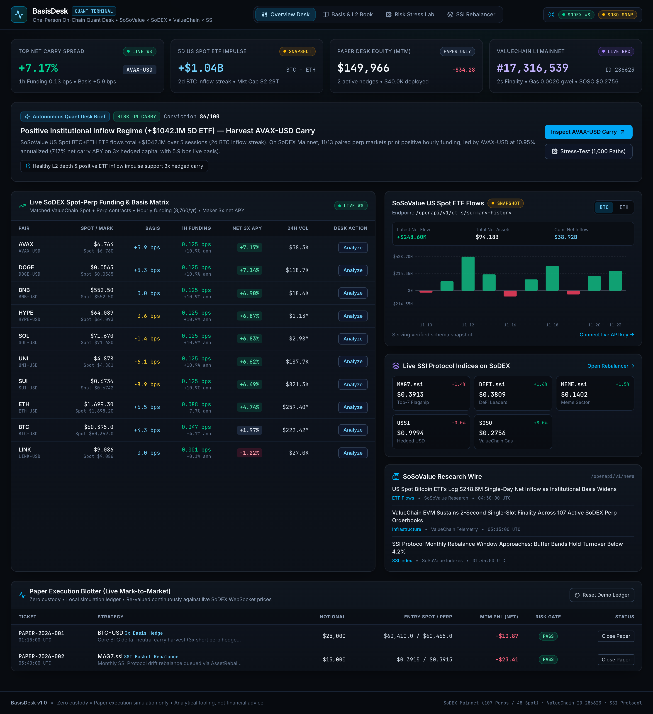
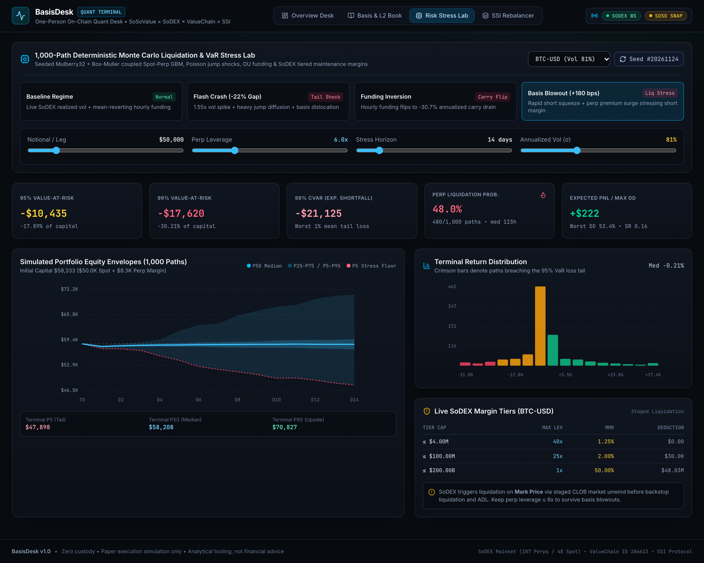
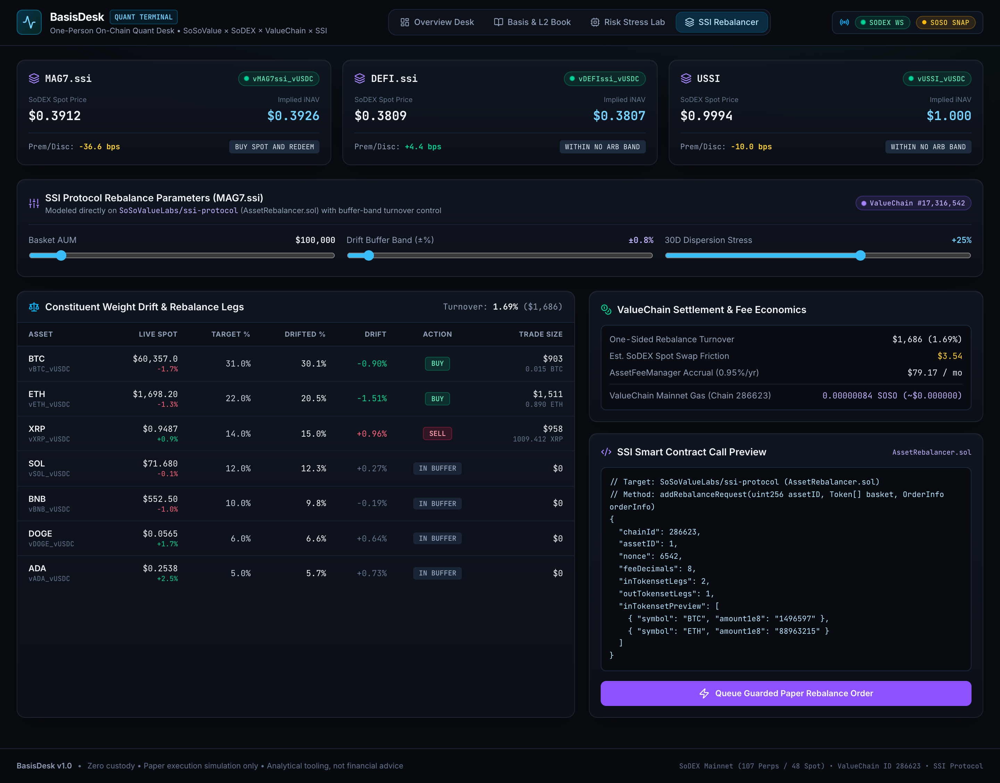
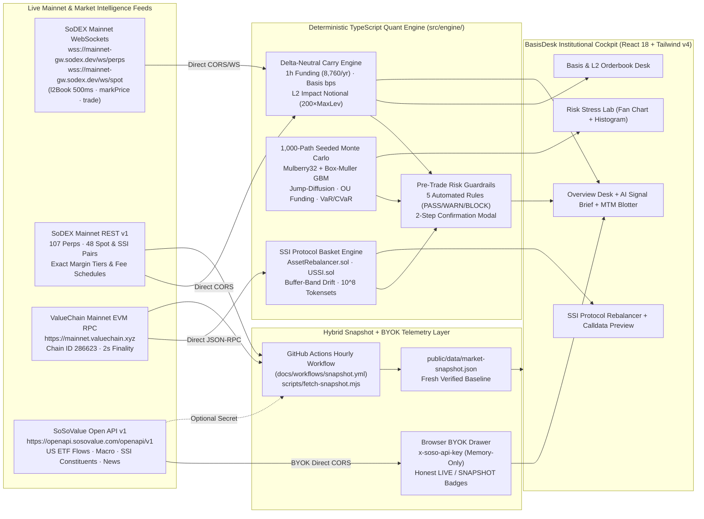

# BasisDesk — Autonomous One-Person On-Chain Quant & Risk Terminal

> **Built for AKINDO WaveHack (Wave 3 — Build Phase II):** *Build Your One-Person On-Chain Finance Business with SoSoValue × ValueChain × SoDEX*
> **Live App (GitHub Pages):** [https://alphonshhhomenicmtu.github.io/basisdesk-soso/](https://alphonshhhomenicmtu.github.io/basisdesk-soso/) • **Custody:** Zero custody, paper execution simulation only • **Disclaimer:** Analytical tooling — not financial advice.

BasisDesk turns a solo trader or independent researcher into a disciplined on-chain quant desk. It unifies **live SoDEX Mainnet perpetual and spot orderbooks**, **SoSoValue ETF flow and macro intelligence**, **ValueChain Mainnet EVM finality telemetry**, and **SSI Protocol smart contract basket rebalancing** into one institutional cockpit with deterministic Monte Carlo risk controls and a 2-step guarded paper execution blotter.

---

## Visual Walkthrough

| Overview Desk (Live Carry Matrix + ETF Flows + Paper Blotter) | Live SoDEX Basis & 500ms L2 Orderbook Desk |
| :---: | :---: |
|  |  |

| 1,000-Path Monte Carlo Liquidation & VaR Stress Lab | SSI Protocol Index Rebalancer & ValueChain Settlement |
| :---: | :---: |
|  |  |

---

## System Architecture



---

## Live Integrations & Honest Telemetry

BasisDesk never disguises simulated or cached numbers as live feeds. Every module carries an explicit telemetry badge (`LIVE WS`, `LIVE REST`, `LIVE RPC`, `LIVE API`, `SNAPSHOT`, or `FALLBACK`):

| Ecosystem Pillar | Verified Endpoint / Contract | Live Mode | Fallback / Resilience |
| :--- | :--- | :--- | :--- |
| **SoDEX Perps** | `wss://mainnet-gw.sodex.dev/ws/perps` & `/api/v1/perps/markets/*` | **LIVE WS + REST** (zero key, CORS `*`) — 107 contracts, 500ms `l2Book`, `markPrice`, hourly `fundingRate`, `marginTiers` | Hourly `market-snapshot.json` baseline |
| **SoDEX Spot & SSI** | `wss://mainnet-gw.sodex.dev/ws/spot` & `/api/v1/spot/markets/*` | **LIVE WS + REST** (zero key, CORS `*`) — 48 spot pairs including `vMAG7ssi_vUSDC`, `vDEFIssi_vUSDC`, `vMEMEssi_vUSDC`, `vUSSI_vUSDC`, `WSOSO_vUSDC` | Hourly `market-snapshot.json` baseline |
| **ValueChain L1 EVM** | `https://mainnet.valuechain.xyz` (Chain ID `286623`, 2s finality) | **LIVE RPC** (polled every 6s for `eth_blockNumber` & `eth_gasPrice`) | Latest captured block height in snapshot |
| **SoSoValue Open API v1** | `https://openapi.sosovalue.com/openapi/v1/{etfs/summary-history,market/overview,indices/ssimag7/constituents,news}` | **LIVE API (BYOK)** — paste free `x-soso-api-key` in Telemetry Drawer (memory-only, CORS-enabled) OR set `SOSOVALUE_API_KEY` GitHub Secret | Hourly CI snapshot + verified v1 schema baseline labeled `SNAPSHOT` |
| **SSI Protocol Contracts** | `github.com/SoSoValueLabs/ssi-protocol` (`AssetRebalancer.sol`, `AssetToken.sol`, `AssetFeeManager.sol`, `USSI.sol`) | Live ValueChain gas pricing (`SOSO`) + live constituent spot feeds on SoDEX | Deterministic `10^8` tokenset & fee preview |

---

## Core Quantitative Capabilities

1. **Live Spot-Perp Funding & Basis Carry Engine (`src/engine/quant.ts`)**
   - Pairs live SoDEX Perp contracts against their matching ValueChain Spot markets (`vBTC_vUSDC` ↔ `BTC-USD`, `vETH_vUSDC` ↔ `ETH-USD`, `vSOL_vUSDC` ↔ `SOL-USD`, etc.).
   - Implements SoDEX's exact **1-hour funding schedule** (`8,760` intervals/year), exact Maker/Taker fee tiers (`1.2 / 4.0 bps` perps; `3.5 / 6.5 bps` spot), live L2 book slippage walking, and official **Impact Notional (`200 USD × Max Leverage`)** premium calculation.
2. **1,000-Path Deterministic Monte Carlo Liquidation & VaR Stress Lab (`src/engine/quant.ts`)**
   - Uses seeded Mulberry32 PRNG + Box-Muller normal draws for reproducible stress tests.
   - Simulates coupled Spot GBM + Poisson jump shocks + Ornstein-Uhlenbeck basis dispersion + hourly funding mean reversion, checking perp margin equity at every step against **live SoDEX `marginTiers`** (`MMR × Notional - Maintenance Deduction`).
   - Outputs 95% / 99% VaR, 99% CVaR (Expected Shortfall), Perp Liquidation Probability, Median Time-to-Liquidation, P5–P95 Equity Fan Chart, and Terminal Return Histogram across 4 stress regimes (*Baseline*, *Flash Crash -22%*, *Funding Inversion*, *Basis Blowout +180 bps*).
3. **SSI Protocol Index Rebalancer & iNAV Monitor (`src/engine/ssiRebalancer.ts`)**
   - Tracks `MAG7.ssi`, `DEFI.ssi`, and `USSI` live on SoDEX Spot against implied basket NAV (`iNAV`) to flag mint/redeem arbitrage bands.
   - Applies SSI Protocol's configurable **drift buffer band** to suppress noisy turnover, scales constituent rebalance legs to `AssetToken` 8-decimal units (`10^8`), estimates `AssetFeeManager` accrual (`feeDecimals = 8`), and previews `AssetRebalancer.addRebalanceRequest` / `USSI.applyMint(HedgeOrder)` payloads with live ValueChain `SOSO` gas costs.
4. **Institutional Risk Controls & Guarded Paper Execution Blotter**
   - Every staged carry or rebalance order must pass 5 automated pre-trade guardrails (Max Leverage, Min Mark-to-Liquidation Buffer, Max L2 Slippage, Single-Strategy Capital Concentration, and 99% VaR Budget) and an explicit 2-step confirmation modal before logging to the live mark-to-market Paper Blotter.

---

## Quick Start & Deployment

### Local Development
```bash
npm install
npm run snapshot   # Refresh live SoDEX + ValueChain (+ optional SOSOVALUE_API_KEY) baseline
npm test           # Run Vitest unit suite (100% pass)
npm run dev        # Launch local development terminal
```

### Static Production Build & 1-Click GitHub Pages
```bash
npm run lint       # Strict TypeScript check
npm run build      # Builds relative-path static bundle into ./dist
npm run preview    # Preview production dist/ locally at http://127.0.0.1:4173
```
Live deployment is hosted from the `gh-pages` branch at **[https://alphonshhhomenicmtu.github.io/basisdesk-soso/](https://alphonshhhomenicmtu.github.io/basisdesk-soso/)**. Optional GitHub Actions workflow templates are included in `docs/workflows/` (copy to `.github/workflows/` if you want automated CI deploys and hourly snapshot commits):
- [`docs/workflows/deploy-pages.yml`](docs/workflows/deploy-pages.yml) — Runs tests, builds `dist/`, and deploys to GitHub Pages.
- [`docs/workflows/snapshot.yml`](docs/workflows/snapshot.yml) — Runs hourly (`0 * * * *`) to refresh `public/data/market-snapshot.json` (add `SOSOVALUE_API_KEY` under Repository Secrets for automated live SoSoValue snapshots).

---

## 2-Minute Walkthrough Demo Script

- **0:00 – 0:25 | The Solo Quant Problem & Overview Desk**
  Open BasisDesk on **Overview Desk**. Point to the live header telemetry (`SODEX WS`, `VALUECHAIN RPC` advancing every 2s, and honest `SOSO SNAP` badge). Show how the **Autonomous Quant Desk Brief** fuses SoSoValue US Spot ETF 5-day flow momentum with live SoDEX hourly funding breadth across matched Spot-Perp pairs to surface the highest-conviction carry trade immediately.
- **0:25 – 0:55 | Live SoDEX Basis & 500ms L2 Orderbook Desk**
  Click **Analyze** on `BTC-USD` (or `SOL-USD`) to enter **Basis & L2 Book**. Highlight the live 500ms WebSocket depth ladder, matching-engine trade tape, official `200 × MaxLeverage` Impact Notional premium, and paired Spot CLOB leg (`vBTC_vUSDC`). Adjust Notional Size and Leverage sliders to show real-time Net Carry APY after exact SoDEX Maker/Taker fees, breakeven holding days, and tiered liquidation distance.
- **0:55 – 1:25 | 1,000-Path Monte Carlo Liquidation Stress Lab**
  Switch to **Risk Stress Lab**. Toggle from **Baseline Regime** to **Basis Blowout (+180 bps)** and push leverage from `3x` to `12x` — watch 1,000 deterministic paths recompute instantaneously, exposing how short-perp margin squeezes elevate Liquidation Probability and 99% CVaR even on a delta-neutral trade, backed by live SoDEX `marginTiers`.
- **1:25 – 1:45 | SSI Protocol Rebalancer & ValueChain Settlement**
  Switch to **SSI Rebalancer**. Show live SoDEX Spot pricing for `MAG7.ssi`, `DEFI.ssi`, and `USSI` versus Implied NAV (`iNAV`). Adjust the **Drift Buffer Band** to demonstrate how SSI's buffer rule eliminates wasteful swap turnover, while generating a live `AssetRebalancer.sol` `10^8` tokenset call preview priced with live ValueChain Mainnet `SOSO` gas.
- **1:45 – 2:00 | Pre-Trade Risk Controls & Guarded Paper Blotter**
  Click **Stage Guarded Paper Carry Order** (or **Queue Paper Rebalance**). Show the **Pre-Trade Risk Gate** auditing all 5 policy rules, check the zero-custody confirmation box, commit to the **Paper Execution Blotter**, and highlight live mark-to-market valuation plus the BYOK **Telemetry Drawer** for instant live SoSoValue API upgrades.

---

## Wave 3 Progress Changelog

- **v1.0 (Wave 3 — Build Phase II Complete):**
  - Integrated live dual SoDEX Mainnet WebSockets (`ws/perps` + `ws/spot`) and REST v1 gateways (`107` perps, `48` spot/SSI markets).
  - Connected live ValueChain Mainnet EVM JSON-RPC (`Chain ID 286623`, 2s slot telemetry, live `SOSO` gas pricing).
  - Implemented genuine SoSoValue Open API v1 BYOK direct client + automated hourly GitHub Actions snapshot pipeline with honest telemetry labeling.
  - Built deterministic TypeScript quant engine: delta-neutral hourly carry calculator, 1,000-path seeded Monte Carlo VaR/CVaR & liquidation simulator, and SSI Protocol (`AssetRebalancer.sol` / `USSI.sol`) basket rebalancer.
  - Added 5-rule institutional Pre-Trade Risk Guardrails, 2-step confirmation modal, persistent MTM Paper Blotter, 16 passing Vitest unit tests, and Retina-verified static GitHub Pages build.
